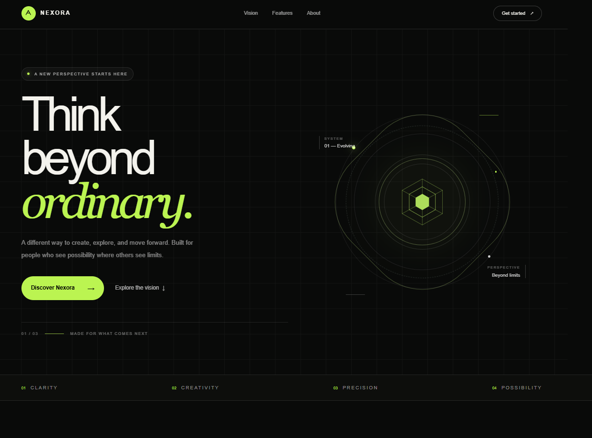
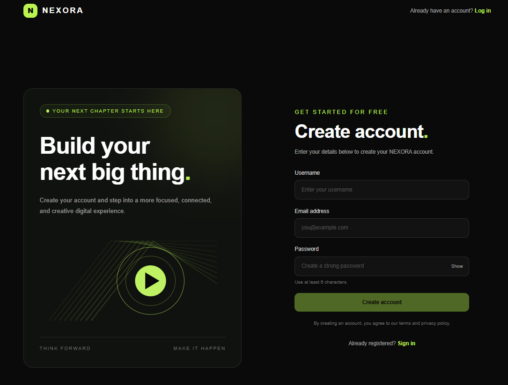
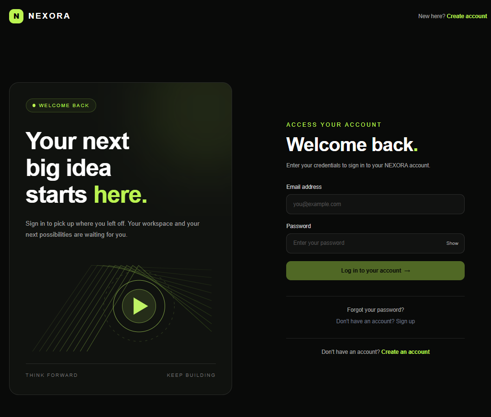
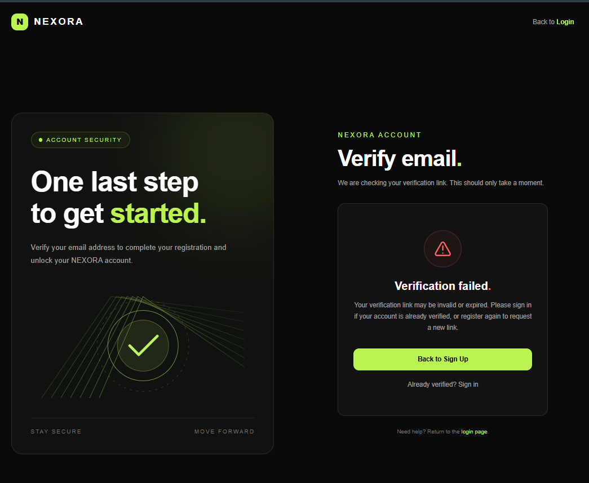
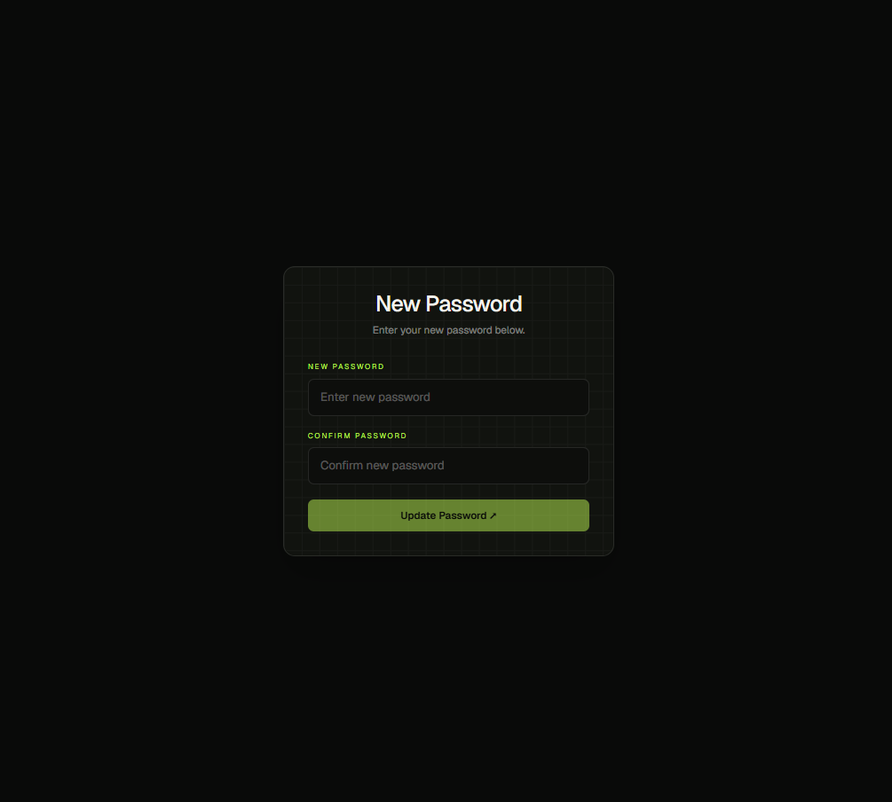
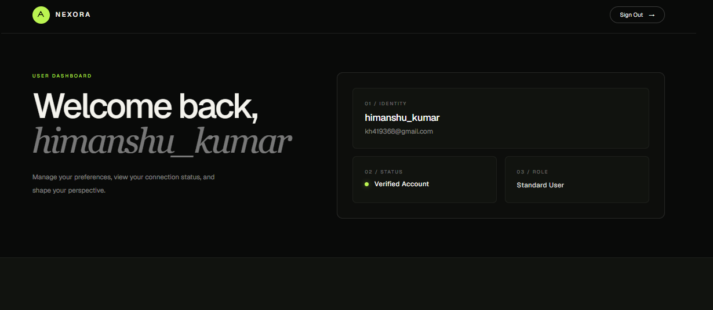

# Nexora Auth

A complete, production-ready full-stack authentication system built with Next.js (App Router). It features a modern, dark-themed UI with lime-green accents and implements secure, industry-standard authentication flows including email verification and password resets.

## 🚀 Features

* **Secure Authentication:** Passwords hashed with `bcryptjs`.
* **Complete User Flows:** Registration, Login, and Logout.
* **Email Verification:** Nodemailer integration with expiring secure tokens.
* **Password Recovery:** Secure Forgot/Reset password flows.
* **Modern UI:** Responsive, sleek dark-mode aesthetic built with Tailwind CSS. (Designed by AI)
* **Toast Notifications:** Real-time user feedback using `react-hot-toast`.

## 🛠️ Tech Stack

* **Framework:** Next.js (App Router)
* **Database:** MongoDB (with Mongoose)
* **Styling:** Tailwind CSS
* **API Calls:** Axios
* **Emails:** Nodemailer
* **Security:** bcryptjs, jsonwebtoken (JWT)

### Homepage / Vision

### Authentication
| Sign Up | Log In |
| :---: | :---: |
|  |  |

### Email Verification
| Verify Email Loading |
| :---: | 
| 

### Password Recovery
| Forgot Password | 
| :---: | 
|  

### User Dashboard

